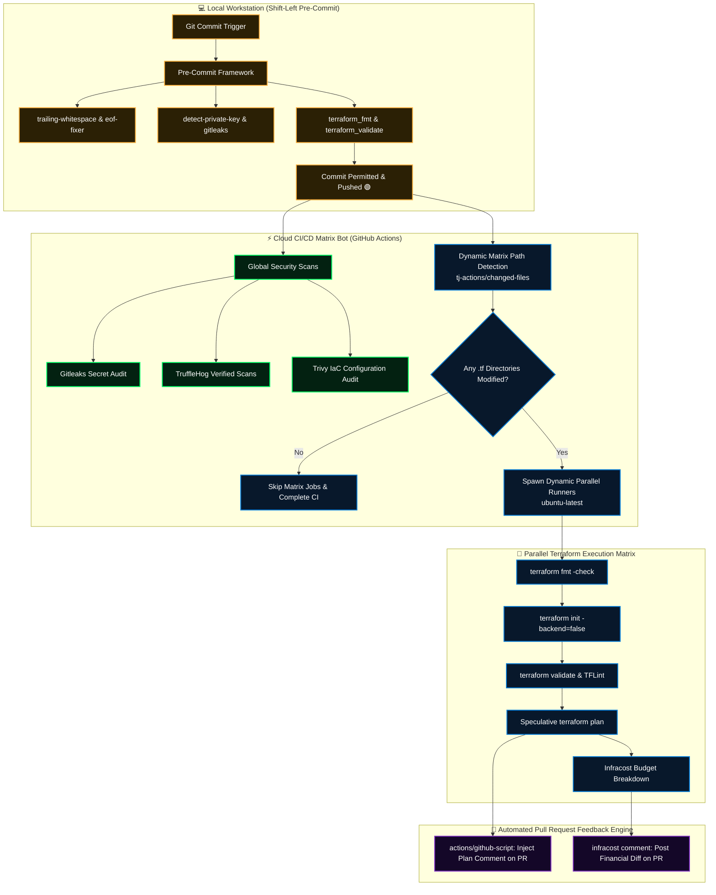

<div align="center">

# 🤖 Enterprise Multi-Directory Terraform CI/CD Bot & Pre-Commit Security Engine
### Dynamic Matrix Change Detection, Autonomous Pull Request Telemetry, Infracost FinOps & Client-Side Git Hooks

[](https://github.com/MihirMaurya-dev/Master_PipeLine/actions/workflows/terraform.yml)
[](https://azure.microsoft.com)
[](https://terraform.io)
[](https://github.com/features/actions)
[](https://www.infracost.io/)
[](https://pre-commit.com/)

**Architected by [Mihir Maurya](https://github.com/MihirMaurya-dev) · Cloud Solutions Architect & DevSecOps Engineer**  
[](https://mihirmaurya-dev.github.io/)
[](https://b18g119.online)
[](https://linkedin.com/in/mihirmauryaa1)

</div>

---

## 🧭 Executive Overview

**`Master_PipeLine`** is an advanced DevSecOps automation suite engineered for monorepos and multi-directory Terraform platforms. It merges **client-side git pre-commit hooks** with an autonomous **GitHub Actions CI/CD bot** that dynamically detects file-level modifications, spins up isolated parallel matrix jobs per infrastructure directory, scans for leaked secrets, audits IaC vulnerabilities, and writes execution plans and **Infracost financial breakdowns** directly onto GitHub Pull Requests.



---

## 🧰 Technology Stack & Tooling

<div align="center">

<a href="https://skillicons.dev">
  
</a>

</div>

<br/>

| Domain | Tools & Frameworks | Description & Engineering Role |
|---|---|---|
| ☁️ **Cloud Platform** | Microsoft Azure (`azurerm` v4.73+) | Resource Groups, Virtual Networks, Dynamic Subnets |
| 🏗️ **Infrastructure as Code** | HashiCorp Terraform v1.9+, HCL | Modular directory architecture (`new/modules/infrastructure`) |
| 🤖 **Automation Bot** | GitHub Actions & `actions/github-script@v7` | Dynamic matrix path detection & automated PR telemetry commenting |
| 💰 **FinOps & Cost Governance** | Infracost CLI & GitHub Actions Action | Automated monthly cost breakdown & PR financial delta posting |
| 🔐 **DevSecOps & Supply Chain** | Gitleaks, TruffleHog, Trivy, TFLint | High-entropy secret detection, verified token scanning & SAST |
| 🛡️ **Client-Side Shift-Left** | Pre-Commit Framework v4.4+ | Pre-commit git hooks preventing bad commits from reaching remotes |

---

## 📂 Repository Topology

```plaintext
Master_PipeLine/
├── .github/
│   └── workflows/
│       └── terraform.yml           # 🤖 Autonomous Multi-Directory Matrix Bot
├── .vscode/
│   ├── extensions.json             # Recommended developer IDE extensions
│   └── settings.json               # VSCode linting, formatting & Terraform configs
├── new/                            # 📦 Target Infrastructure Module
│   ├── modules/
│   │   └── infrastructure/         # 🏛️ Core Cloud Blueprint Module
│   │       ├── main.tf             # Azure RG, VNet & Subnet definitions
│   │       ├── outputs.tf          # Exported resource identifiers
│   │       └── variables.tf        # CIDR blocks & regional parameters
│   ├── main.tf                     # Root caller invoking ./modules/infrastructure
│   └── variable.tf                 # Base naming & region validation constraints
├── .gitignore                      # Terraform caches, plan files & secret exclusions
├── .pre-commit-config.yaml         # 🛡️ Declarative Client-Side Git Hooks Specification
└── README.md                       # Enterprise Architectural Documentation
```

---

## 🛡️ Pre-Commit Shift-Left Security Specifications

The client-side gating framework is defined in [`.pre-commit-config.yaml`](./.pre-commit-config.yaml) and executes locally on every `git commit`:

```yaml
repos:
  # 1. Cleanliness & Integrity
  - repo: https://github.com/pre-commit/pre-commit-hooks
    rev: v4.4.0
    hooks:
      - id: trailing-whitespace
      - id: end-of-file-fixer
      - id: check-yaml
      - id: check-merge-conflict
      - id: detect-private-key

  # 2. Terraform Static Verification
  - repo: https://github.com/antonbabenko/pre-commit-terraform
    rev: v1.81.0
    hooks:
      - id: terraform_fmt
      - id: terraform_validate
      - id: terraform_tflint

  # 3. Secret Leak Prevention
  - repo: https://github.com/gitleaks/gitleaks
    rev: v8.18.0
    hooks:
      - id: gitleaks
```

---

## 🤖 The CI/CD Matrix Bot Workflow Lifecycle

### Stage 1: Global Security & Secret Scanners
Executes across the full repository on push/PR:
- **Gitleaks**: Scans commit history for API tokens, certificates, and private credentials.
- **TruffleHog**: Audits high-entropy strings and verifies live validity against known provider endpoints.
- **Trivy**: Evaluates Terraform configuration against CIS Microsoft Azure Security benchmarks.

### Stage 2: Dynamic Matrix Path Detection
Rather than running full pipelines blindly across unchanged directories, the bot leverages `tj-actions/changed-files@v44` to identify only directories containing `.tf` file modifications. It emits a dynamic JSON array:
```json
["new", "environments/prod"]
```

### Stage 3: Dynamic Parallel Runners & PR Feedback
For each directory in the matrix:
1. Initializes Terraform with `-backend=false` for stateless validation.
2. Checks syntax formatting and deep schema correctness (`terraform validate`).
3. Executes **TFLint** with modular rulesets.
4. Generates an execution plan and **posts the formatted plan diff directly into the PR comments**.
5. Runs **Infracost** to estimate cloud costs and injects an interactive table showing monthly operational cost deltas.

---

## ⚡ Local Setup & Hook Installation

### 1. Install Pre-Commit Framework
```bash
# Using pip
pip install pre-commit

# Or using Homebrew / Chocolatey
choco install pre-commit
```

### 2. Install Git Hooks
```bash
cd Master_PipeLine
pre-commit install
```

### 3. Run Pre-Commit Across All Files
```bash
pre-commit run --all-files
```

### 4. Test Infrastructure Locally
```bash
cd new
terraform init -backend=false
terraform fmt -check
terraform validate
```

---

## 👨‍💻 Author & Engineering Profile

**Mihir Maurya**  
*Cloud Solutions Architect & DevSecOps Engineer*  
*M.Sc Computer Science & Computer Applications & Mathematics Graduate*

* 🌐 **Portfolio**: [mihirmaurya-dev.github.io](https://mihirmaurya-dev.github.io/)
* 🚀 **Live Production Platform**: [b18g119.online](https://b18g119.online)
* 💼 **LinkedIn**: [linkedin.com/in/mihirmauryaa1](https://linkedin.com/in/mihirmauryaa1)
* 🐙 **GitHub**: [@MihirMaurya-dev](https://github.com/MihirMaurya-dev)

---

<div align="center">

**[Overview](#-executive-overview)** · **[Architecture Diagram](#-executive-overview)** · **[Tech Stack](#-technology-stack--tooling)** · **[Pre-Commit Spec](#-pre-commit-shift-left-security-specifications)** · **[Bot Workflow](#-the-cicd-matrix-bot-workflow-lifecycle)**

*Engineered with precision for zero-trust cloud infrastructure and automated GitOps feedback.*

</div>
